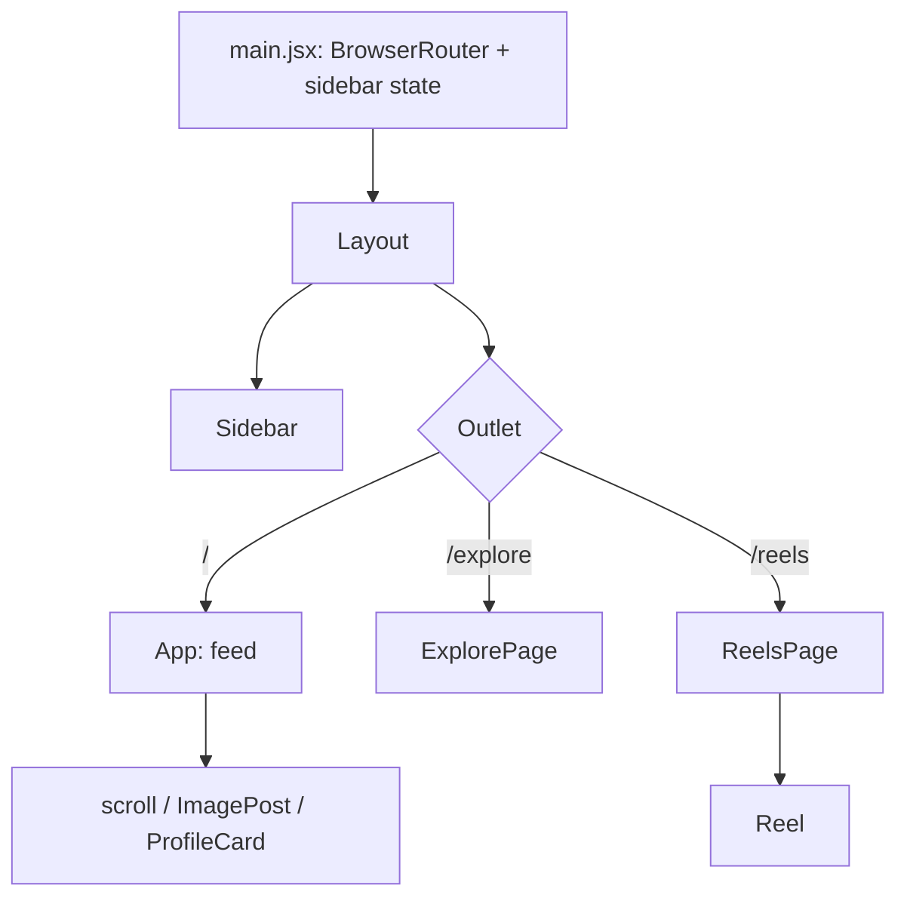

# Lumigram

> A social media interface (feed, explore grid, reels) built with React, Vite and Tailwind CSS.

**Status: UI prototype.** All content is static demo data; there is no backend, authentication or persistence. This is an independent learning project, not affiliated with or endorsed by any social media company.

## What it includes

- **Home feed** with a horizontally scrollable stories bar, image posts and a suggestions column.
- **Explore** grid of videos that play on hover (or keyboard focus) and pause on leave.
- **Reels** page with a vertical video player and an action rail. Reels play only while visible, and a click or Enter/Space pauses them.
- **Collapsible sidebar** with client-side routing and an in-place search panel (UI only).

## Tech stack

React 18, Vite 6, React Router 7, Tailwind CSS 3 (+ `tailwind-scrollbar-hide`), react-icons, ESLint 9, Vitest and Testing Library.

## Architecture



Sidebar collapse state lives in `main.jsx` and is passed to `Layout` and `Sidebar`. Page content is declared as data arrays at the top of each page.

## Project structure

```
src/
  main.jsx            entry, router, sidebar state
  Layout.jsx          sidebar + routed content
  Sidebar.jsx         navigation and search panel
  App.jsx             home feed
  ExplorePage.jsx     video grid
  ReelsPage.jsx       reels list
  components/         ImagePost, ProfileCard, Reel, scroll
public/               demo images, icons and videos
tests/                Vitest tests (asset references, components)
docs/                 architecture, roadmap
```

## Getting started

Requires Node.js 20+.

```bash
npm install
npm run dev
```

## Scripts

| Script | Description |
|---|---|
| `npm run dev` | Start the dev server |
| `npm run build` | Production build |
| `npm run preview` | Preview the production build |
| `npm run lint` | Run ESLint |
| `npm test` | Run the Vitest tests |
| `npm run format` | Prettier (writes; existing code is not yet formatted with it) |

## Limitations

- Static demo data only: likes, follows, comments, create and messages do nothing.
- Fixed pixel widths in several layouts; not responsive on small screens.
- Demo videos in `public/` are large (up to ~38 MB); consider Git LFS or smaller samples.
- Icon and image assets in `public/` are demo material of unverified origin; replace them with assets you have rights to before publishing a deployed version.
- The tests were written without being run in a development environment, and CI has not been exercised yet. `package-lock.json` predates the test dependencies, so CI uses `npm install` until it is regenerated.
- Reels do not yet respect `prefers-reduced-motion`.

## Roadmap

- [ ] Responsive layout
- [ ] API-backed feed with authentication
- [ ] Like, follow and comment interactions
- [ ] More in [docs/ROADMAP.md](docs/ROADMAP.md)

## More documentation

[docs/index.md](docs/index.md) · [Security policy](SECURITY.md)

## License

Code: [MIT](LICENSE) © 2026 Praneetha Potharaju. Media assets in `public/` are not covered by this license.
