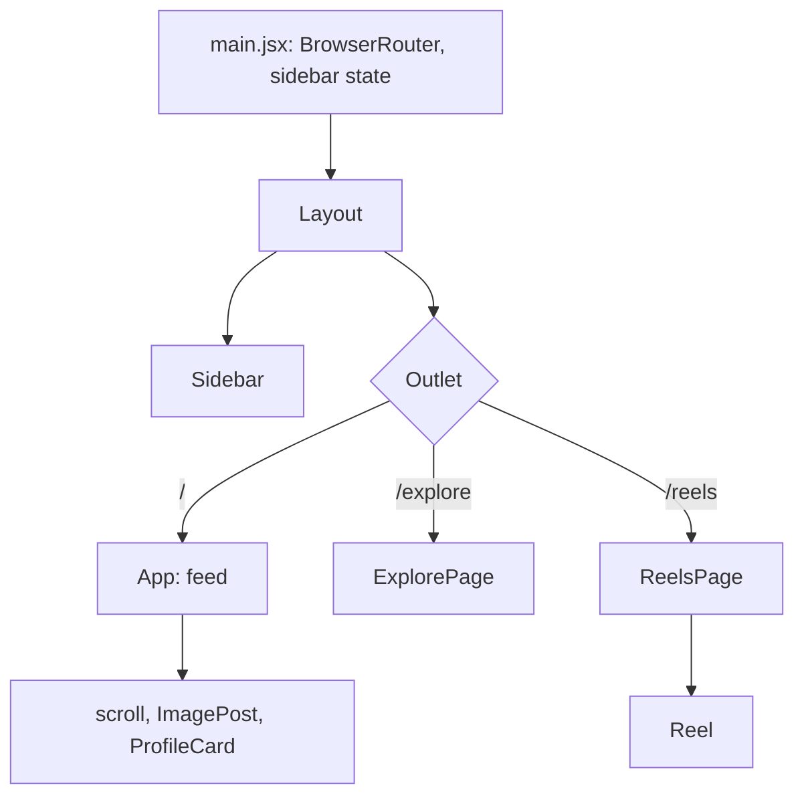

# Lumigram architecture

Lumigram is a client-only single-page application. There is no server, network call or persistence.

## Structure

## Decisions

- **Routing.** React Router 7 with a layout route. `Sidebar` uses `NavLink`, which sets `aria-current="page"` for the active route.
- **State.** The only shared state is the sidebar collapse flag, held in `main.jsx` and passed down as props. The "Search" item toggles it and the search panel is rendered while collapsed. `aria-expanded` reflects that state.
- **Data.** Each page declares its demo content as an array at the top of the file. Replacing these arrays with fetched data is the first step toward a real backend.
- **Media.** Explore videos load on demand (`preload="none"`) and play on hover or keyboard focus. Reels play only while at least 60% visible (`IntersectionObserver`), and a click or Enter/Space pauses them.
- **Styling.** Tailwind CSS 3 utility classes. Several layouts use fixed pixel widths, so the interface is designed for wide screens.

## Accessibility

Landmarks (`nav`, `main`, `aside`), a visually hidden `h1` per page, labelled icon buttons, decorative images with empty `alt`, and text colours chosen for AA contrast. Motion can be paused. Not yet measured with an automated audit.

## Testing

Vitest with Testing Library (jsdom). `tests/assets.test.js` fails if any literal `/file.ext` referenced in source is missing from `public/`, which would have caught earlier missing posters.
